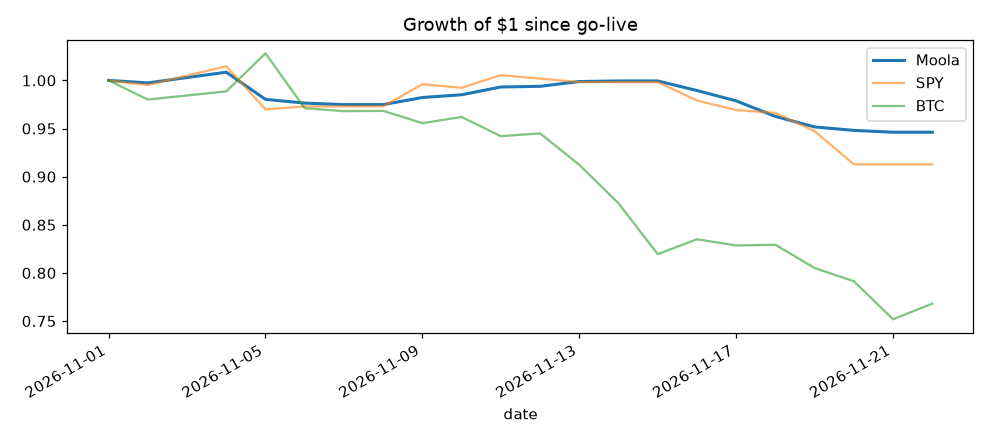

# Moola results summary

_Generated 2026-11-24 21:30 UTC. Auto-generated by `moola.report`, do not edit._

- **Strategy version:** v1
- **Live since:** 2026-11-01 (23 runs)
- **Equity:** $96,625.78 (cumulative P&L $-3,374.22)
- **Exposure:** gross 75.31%, crypto 0.00%

## Performance

| window | return | Sharpe | max DD | SPY | BTC |
|---|---|---|---|---|---|
| last 7 days | -1.35% | -3.57 | -3.33% | -1.86% | -5.59% |
| last 30 days | -3.44% | -3.12 | -6.18% | -4.89% | -21.78% |
| since start | -3.44% | -3.12 | -6.18% | -4.89% | -21.78% |

## By strategy version

| version | from | to | runs | return | Sharpe |
|---|---|---|---|---|---|
| v1 | 2026-11-01 | 2026-11-24 | 23 | -3.44% | -3.12 |

## Current positions (2026-11-24)

| symbol | market value | weight | unrealized P&L |
|---|---|---|---|
| XLV | $24,531 | 25.39% | $-85 (-0.34%) |
| XLF | $24,131 | 24.97% | $273 (1.15%) |
| XLE | $24,108 | 24.95% | $251 (1.05%) |

## Approximate P&L attribution since start

| symbol | P&L |
|---|---|
| XLF | $-1,365 |
| XLE | $-1,207 |
| XLV | $-720 |
| BTC/USD | $-388 |
| SPY | $-349 |
| ETH/USD | $0 |

## Execution

- Orders submitted: 55
- Orders rejected/errored: 0
- Fills: 55, mean slippage -13.8 bps (worst 353.1 bps)

## Risk flags (last 14 runs)

- 2026-11-11: capped XLF from 27.5% to 25%
- 2026-11-11: capped SPY from 30.1% to 25%
- 2026-11-12: capped XLV from 35.4% to 25%
- 2026-11-12: capped XLE from 26.1% to 25%
- 2026-11-12: capped XLF from 38.5% to 25%
- 2026-11-13: capped XLV from 25.3% to 25%
- 2026-11-13: capped XLF from 26.9% to 25%
- 2026-11-13: capped SPY from 29.6% to 25%
- 2026-11-14: capped XLV from 25.3% to 25%
- 2026-11-14: capped XLF from 26.9% to 25%
- 2026-11-14: capped SPY from 29.6% to 25%
- 2026-11-15: capped XLV from 25.3% to 25%
- 2026-11-15: capped XLF from 26.9% to 25%
- 2026-11-15: capped SPY from 29.6% to 25%
- 2026-11-16: capped XLV from 36.2% to 25%
- 2026-11-16: capped XLF from 38.3% to 25%
- 2026-11-16: capped XLE from 25.4% to 25%
- 2026-11-17: capped XLV from 36.1% to 25%
- 2026-11-17: capped XLF from 38.2% to 25%
- 2026-11-17: capped XLE from 25.8% to 25%
- 2026-11-18: capped XLV from 35.7% to 25%
- 2026-11-18: capped XLF from 38.7% to 25%
- 2026-11-18: capped XLE from 25.6% to 25%
- 2026-11-19: capped XLV from 35.4% to 25%
- 2026-11-19: capped XLF from 38.6% to 25%
- 2026-11-19: capped XLE from 26.0% to 25%
- 2026-11-20: capped XLV from 100.0% to 25%
- 2026-11-21: capped XLV from 100.0% to 25%
- 2026-11-22: capped XLV from 100.0% to 25%
- 2026-11-23: capped XLV from 36.1% to 25%
- 2026-11-23: capped XLF from 37.5% to 25%
- 2026-11-23: capped XLE from 26.4% to 25%
- 2026-11-24: capped XLV from 35.0% to 25%
- 2026-11-24: capped XLF from 38.0% to 25%
- 2026-11-24: capped XLE from 27.1% to 25%

## Data/execution errors (last 14 runs)

None.

