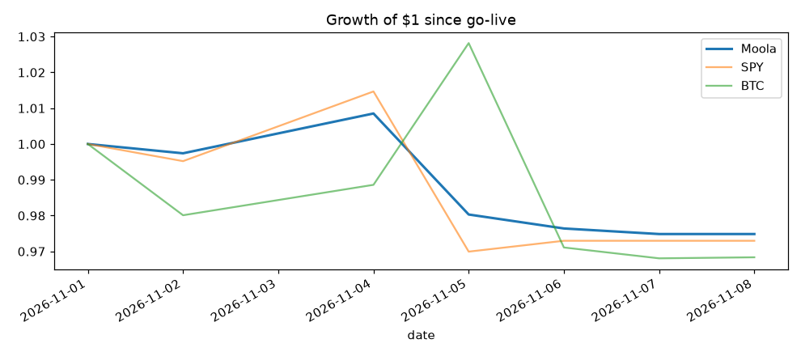

# Moola results summary

_Generated 2026-11-08 21:30 UTC. Auto-generated by `moola.report`, do not edit._

- **Strategy version:** v1
- **Live since:** 2026-11-01 (7 runs)
- **Equity:** $97,556.15 (cumulative P&L $-2,443.85)
- **Exposure:** gross 50.26%, crypto 0.00%

## Performance

| window | return | Sharpe | max DD | SPY | BTC |
|---|---|---|---|---|---|
| last 7 days | -2.52% | -6.19 | -3.34% | -2.70% | -3.16% |
| last 30 days | -2.52% | -6.19 | -3.34% | -2.70% | -3.16% |
| since start | -2.52% | -6.19 | -3.34% | -2.70% | -3.16% |

## By strategy version

| version | from | to | runs | return | Sharpe |
|---|---|---|---|---|---|
| v1 | 2026-11-01 | 2026-11-08 | 7 | -2.52% | -6.19 |

## Current positions (2026-11-08)

| symbol | market value | weight | unrealized P&L |
|---|---|---|---|
| XLV | $24,546 | 25.16% | $-16 (-0.06%) |
| XLE | $24,483 | 25.10% | $-1,732 (-6.61%) |

## Approximate P&L attribution since start

| symbol | P&L |
|---|---|
| XLF | $-715 |
| XLV | $-699 |
| XLE | $-634 |
| BTC/USD | $-388 |
| ETH/USD | $0 |

## Execution

- Orders submitted: 18
- Orders rejected/errored: 0
- Fills: 16, mean slippage -71.9 bps (worst 353.1 bps)

## Risk flags (last 14 runs)

- 2026-11-01: capped XLV from 32.8% to 25%
- 2026-11-01: capped XLE from 27.1% to 25%
- 2026-11-02: capped XLV from 27.7% to 25%
- 2026-11-02: capped XLF from 36.7% to 25%
- 2026-11-04: capped XLV from 28.3% to 25%
- 2026-11-04: capped XLF from 34.3% to 25%
- 2026-11-05: capped XLV from 35.9% to 25%
- 2026-11-05: capped XLE from 28.2% to 25%
- 2026-11-05: scaled crypto from 35.9% to 30%
- 2026-11-06: capped XLV from 33.8% to 25%
- 2026-11-06: capped XLE from 26.5% to 25%
- 2026-11-06: capped XLF from 39.7% to 25%
- 2026-11-07: capped XLV from 33.8% to 25%
- 2026-11-07: capped XLE from 26.5% to 25%
- 2026-11-07: capped XLF from 39.7% to 25%
- 2026-11-08: capped XLV from 33.8% to 25%
- 2026-11-08: capped XLE from 26.5% to 25%
- 2026-11-08: capped XLF from 39.7% to 25%

## Data/execution errors (last 14 runs)

None.

